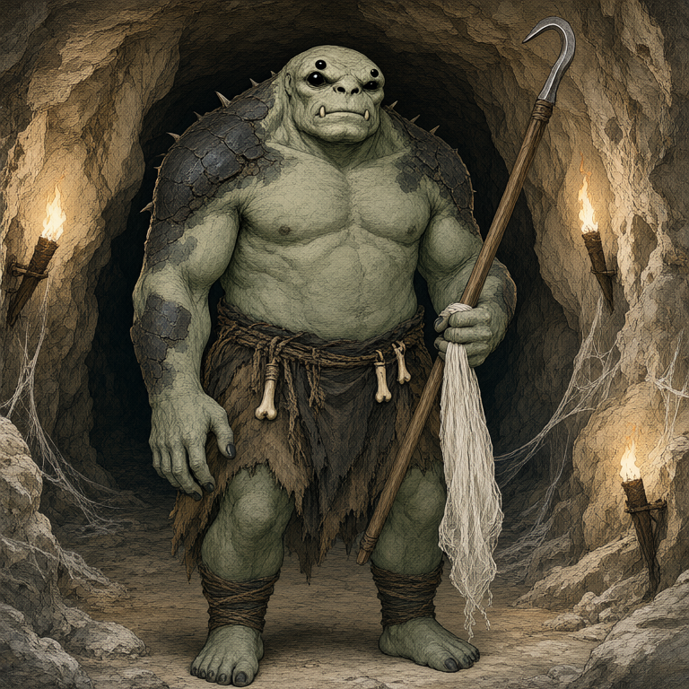
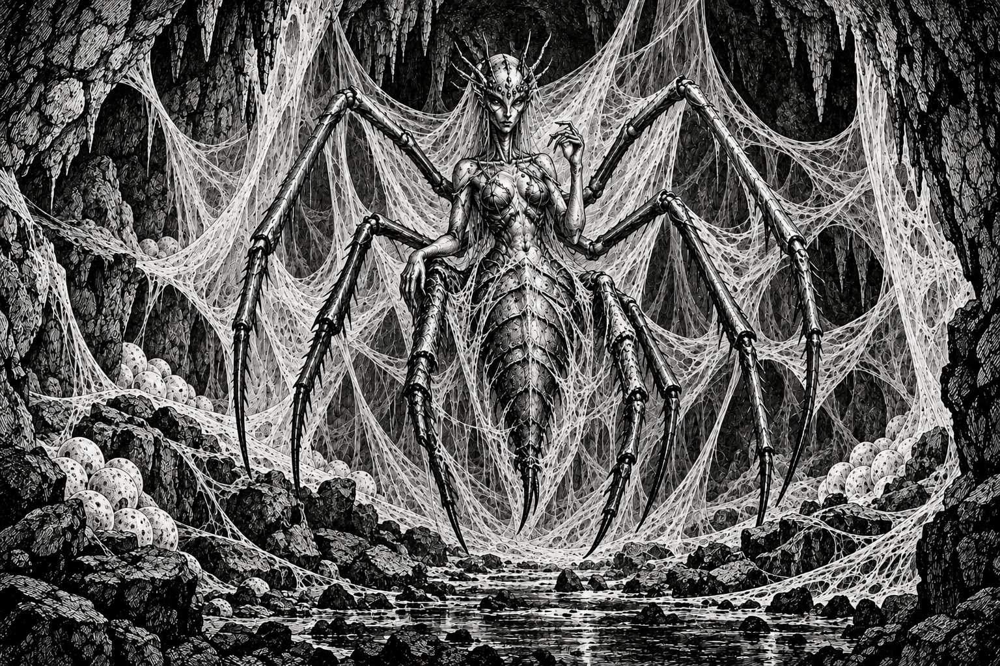

# Greenheart's Captives and Heart Seed

## Where It Stands

[[npc-greenheart|Greenheart]] told the party that many-eyed beings below [[location-quasqueton|Quasqueton]] trap and steal its children with webs. The group agreed to try its best to return the captives or otherwise secure peace. Sab made the commitment conditional on what the party could accomplish and did not promise a timetable.

If successful, Greenheart will provide a heart seed and asks that it be returned to its northern home. No seed has changed hands. In [[2026_1101 Session 21|Session 21]], the party killed one many-eyed hunter in the upper corridors and found a separate nursery of mothers and young. Those greenkin were not established as rescued captives. No rescue or peace agreement was completed; the party ended at an old exercise room without descending.

## Why It Matters

The request gives the expedition an immediate objective involving Quasqueton's living inhabitants and a possible later journey north. The sap vision showed a seed stolen from an elven forest city by a purple-robed wizard, whom the party suspects was Zelligar. Neither his identity nor the forest's present condition is confirmed.

## What Remains Uncertain

- The hunters' species, number, and exact base. One mostly humanoid arachnid-orc was encountered; the psychic link connected it to a spiderlike controller and rat-catching for food. Its descent from Quasqueton's historical captive orcs remains speculation.
- The captives' number and condition, and whether rescue or negotiation can secure peace.
- A route below; a waterfall cave was suggested but not verified.
- The northern home's name, destination, current state, and the seed's transport needs.
- Whether and how the resident rats would relocate; they prefer a more open, safe environment.

## Hunter and Controller

Oogie, Sab, and Orlin shared the hunter's psychic imagery through rapport spores. They saw a great female humanoid-spider figure in a cavernous space, controlling orcish creatures with varying arachnid traits. The hunter conveyed remorse at failing a duty involving catching rats for food. Gradrick and Grond were outside the direct link; the others were expected to relay the information. The vision does not establish the controller's name or location, or whether killing her would free the hunters. “Spider queen” is party shorthand.

The encountered hunter carried a hooked spear and web-like net. After surrendering at Sab's crossbow point and being tied by Gradrick, it spat purple liquid at Orlin that fizzed against stone. He dodged; Oogie's second Fate casting killed it. The weapons were dropped, with no explicit collection.

## Other Upper-Nursery Discoveries

The hidden storeroom held four mothers and roughly thirty young. Orlin reassured them through the Tongue of the Beast and gave a ration. Its enlarged concealed entrance began healing shut, and a second small exit connected to the neighboring corridor. They remained in place.

Oogie's contact with mushrooms showed a greenkin drinking gray liquid from a gray stone pool, stiffening, and dying. He described it as poison; the liquid's nature, pool's location, and timing remain unverified. This is a separate danger clue, not proof that the captives died there.

## Garden Connections

- [Greenheart](../people/npc-greenheart)
- [Quasqueton / Hollow Gate](../places/location-quasqueton)
- [Sab](../party/pc-sab)
- [Orlin](../party/pc-orlin)
- [Oogie](../party/pc-oogie)
- [Gradrick](../party/pc-gradrick)
- [Grond](../party/pc-grond)
