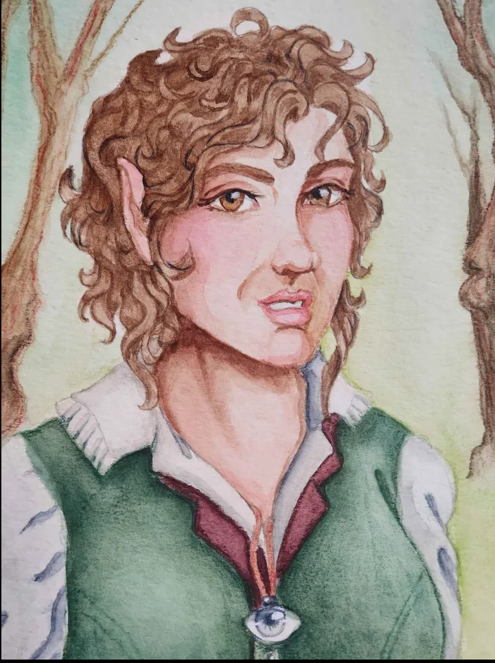
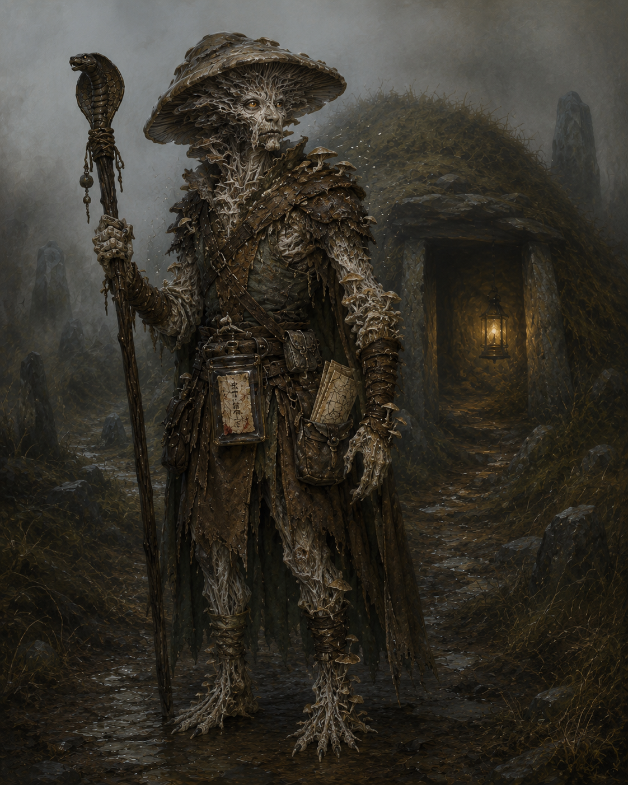
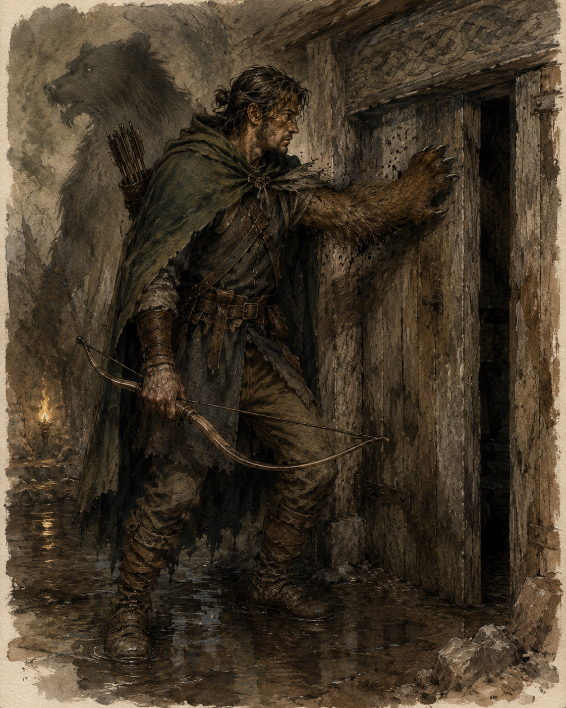
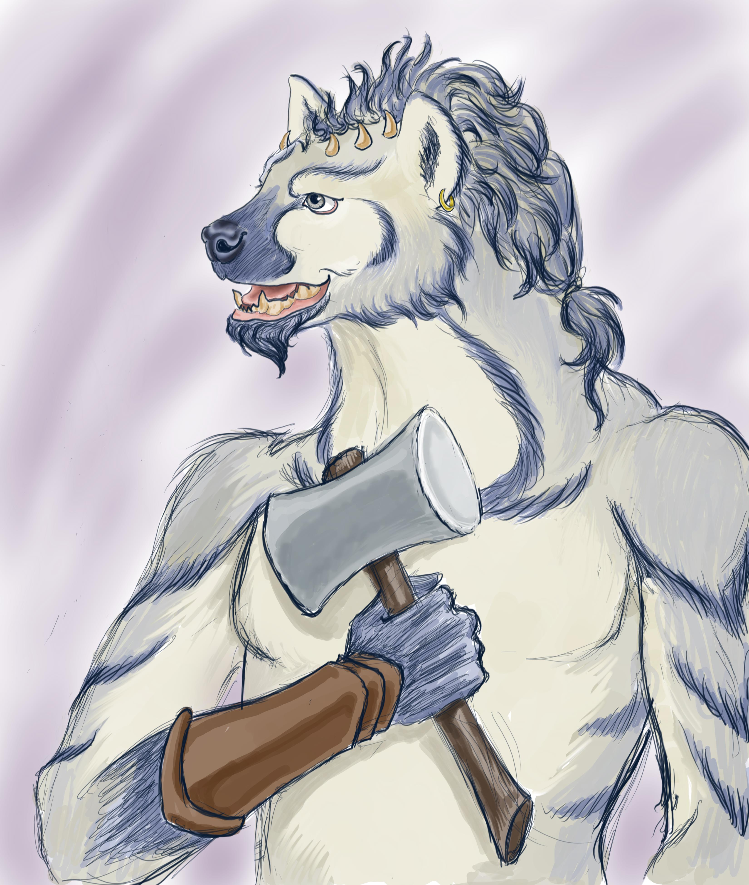
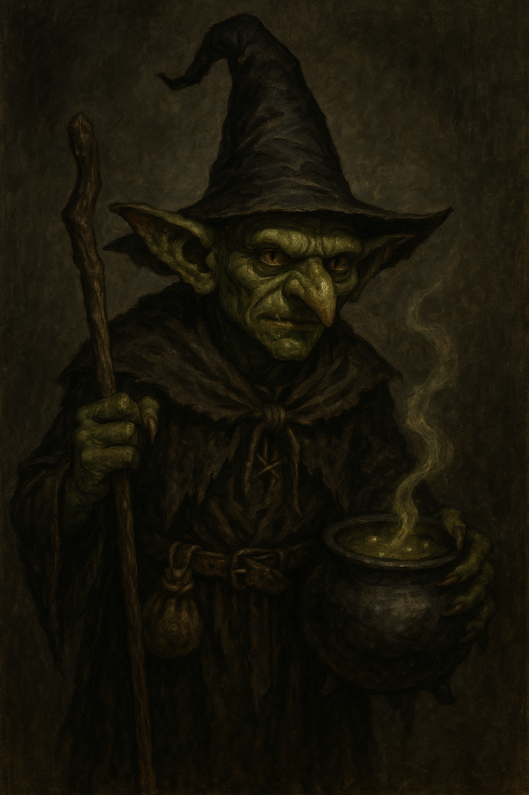
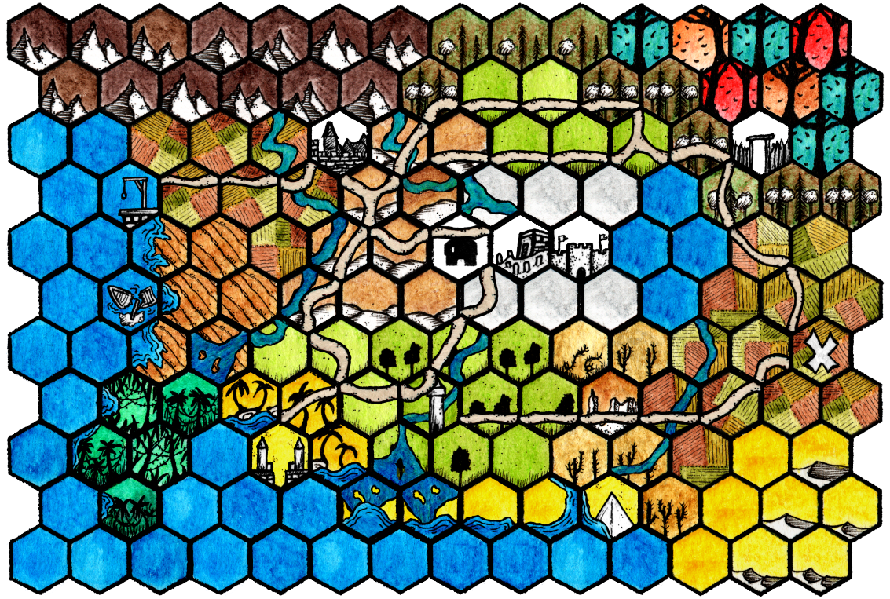

<section class="campaign-hero">

A Shadowdark Campaign Archive

<h2>Hooded Lantern Cartel</h2>

The search for a stolen corpse in the Barrow Mounds led the Hooded Lantern Cartel to Mort, Mara, and Tornar. The damaged Hollow Gate writ and papers recovered with Eldran Vey, Quasqueton's former steward, drew the party out from Helix and…

</section>

## Campaign Now

[Read the full Previously On and current campaign state →](campaign-now/)

## The Party

<a class="party-card internal" href="./party/pc-sab"><strong>Sab</strong><small>Sab is the party's halfling priest: an Old Gods devotee, healer, anti-undead specialist, and frequent voice of caution. Her divine magic, crossbow, and halfling invisibility let her move between support, scouting, and precise violence.</small></a>
<a class="party-card internal" href="./party/pc-oogie"><strong>Oogie</strong><small>Oogie is a Mycellan seer whose trances, omens, and unusual perspective make him the party's occult support and intuitive investigator. His mycelial nature became materially important when the Fair Church restored him in its cemetery…</small></a>
<a class="party-card internal" href="./party/pc-orlin"><strong>Orlin</strong><small>Orlin is a Shadow Elf Beastmaster whose shapechanging, bear-form strength, healing, bow work, and alertness make him a flexible explorer. His bear and wolf forms complement his growing rapport with animals.</small></a>
<a class="party-card internal" href="./party/pc-grond"><strong>Grond</strong><small>Grond is a kobold pit fighter and the party's most direct front-line bruiser. He favors practical force, shields companions in a retreat, and has also shown a surprisingly warm rapport with the people of Helix.</small></a>
<a class="party-card internal" href="./party/pc-gradrick"><strong>Gradrick</strong><small>Gradrick is the party's goblin witch, a back-line spellcaster whose Eyebite and practical magical knowledge have supported the group since its earliest recorded delves.</small></a>
<a class="party-card internal" href="./party/pc-dern">D<strong>Dern</strong><small>Dern is a dwarf Sea Wolf: a Viking-styled martial adventurer introduced during the same strange death-return sequence that restored Oogie.</small></a>

## Latest Session

**Session 23 · 2026-11-15**

The party explored a hidden study off Quasqueton's pool chamber, recovering papers, journals, 90 gold, two healing potions, and the Jewel of Barbalt. After resupplying at Lumpy's, the group found a smithy, a water shaft, a repairs cache,…

[Quick recap and detailed record →](sessions/2026_1115%20Session%2023)

## Threads in Motion

- **[Bag of holding](items/item-bag-of-holding)** — Magic bag identified as having five slots.
- **[Greenheart's Captives and Heart Seed](active-leads/thread-greenheart-captives)** — Greenheart told the party that many-eyed beings below Quasqueton trap and steal its children with webs. The group agreed to try its best to return the captives or otherwise secure peace. Sab made the commitment conditional on what the…
- **[Mazzah](people/npc-mazzah)** — Mazzah is Helix's eccentric wizard and the party's most reliable magical consultant. He is cooperative when approached on his terms, which are advertised by the many increasingly emphatic “do not disturb” signs around his tower.
- **[Mazzah's Tower](places/location-mazahs-tower)** — Mazzah's tower is the Helix wizard's home, workshop, and the party's principal stop for magical identification. It is larger and more comfortable inside than its exterior suggests, and repeated “do not disturb” signs are backed by a…
- **[Quasqueton / Hollow Gate](places/location-quasqueton)** — Quasqueton, called the Hollow Gate in a damaged writ recovered from Tornar's rooms, is the party's current expedition site. After clearing the upper harpy nest and meeting Greenheart, the party continued through the upper corridors in…
- **[The Hollow Gate Writ](active-leads/thread-hollow-gate-writ)** — The party recovered a damaged legal-looking writ from Tornar's rooms. It names the Hollow Gate of Quasqueton and grants a lawful bearer custody of its road-house, outer wall, spring, cave-mouth, stable court, and surrounding grounds,…
- **[Beetle Potion of Animal Shifting](items/item-beetle-potion-of-animal-shifting)** — Grond found this opaque, beetle-shaped bottle in the middle drawer of a clothes cabinet in Quasqueton's hidden study.
- **[Jewel of Barbalt](items/item-jewel-of-barbalt)** — Sab found this coconut-sized cut ruby in a wooden display case inside a trapped desk drawer in Quasqueton's hidden study. In Session 23, Mazzah identified it through the curtained portal.

## Recent Sessions

- **[Session 23 · 2026-11-15](sessions/2026_1115%20Session%2023)** — The party explored a hidden study off Quasqueton's pool chamber, recovering papers, journals, 90 gold, two healing potions, and the Jewel of Barbalt. After resupplying at Lumpy's, the group found a smithy, a water shaft, a repairs cache,…
- **[Session 22 · 2026-11-08](sessions/2026_1108%20Session%2022)** — In Quasqueton, the party cleared giant red centipedes from an exercise room and Sab claimed a magical lion-faced +1 shield. Thorn-bearing greenkin said two “web takers” had come up the eastern stairs, one going north and one west. In a…
- **[Session 21 · 2026-11-01](sessions/2026_1101%20Session%2021)** — The party left Greenheart's nursery and explored more of Quasqueton's upper corridors. They subdued a many-eyed, arachnid-orc hunter and used Oogie's rapport spores to perceive a great spiderlike female controlling similar creatures and…

## The Valley of Ruin

[Open the full map and regional guide](maps/valley-of-ruin)

## Explore

[Campaign Now](campaign-now/) · [Party](party/) · [Sessions](sessions/) · [World](world/) · [Leads](active-leads/) · [Timeline](timeline/) · [Maps](maps/) · [Archive](archive/)
