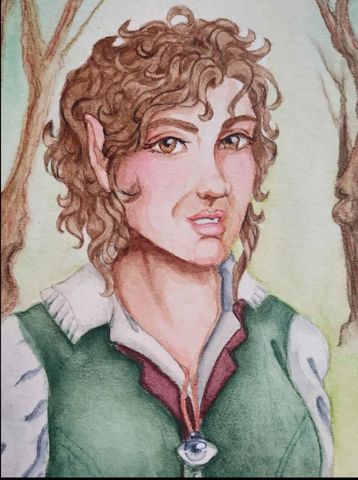
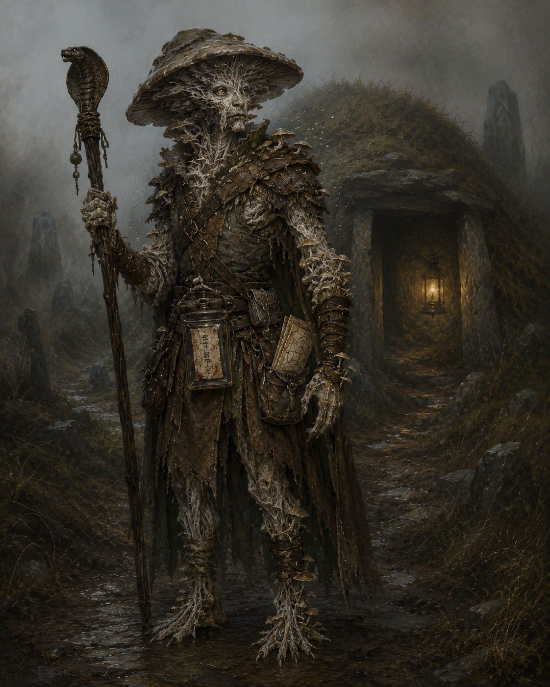
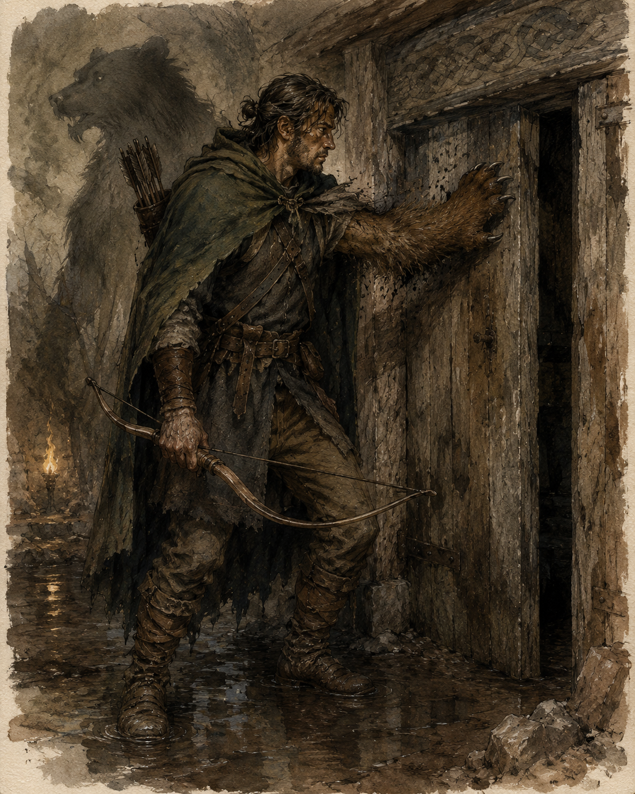
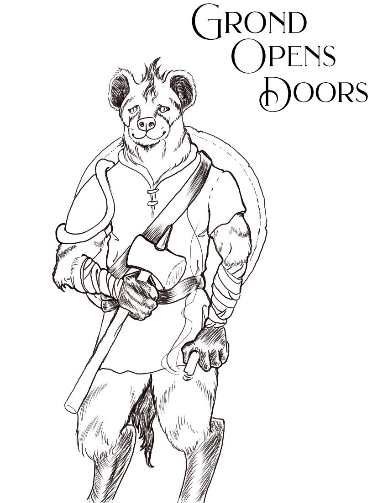
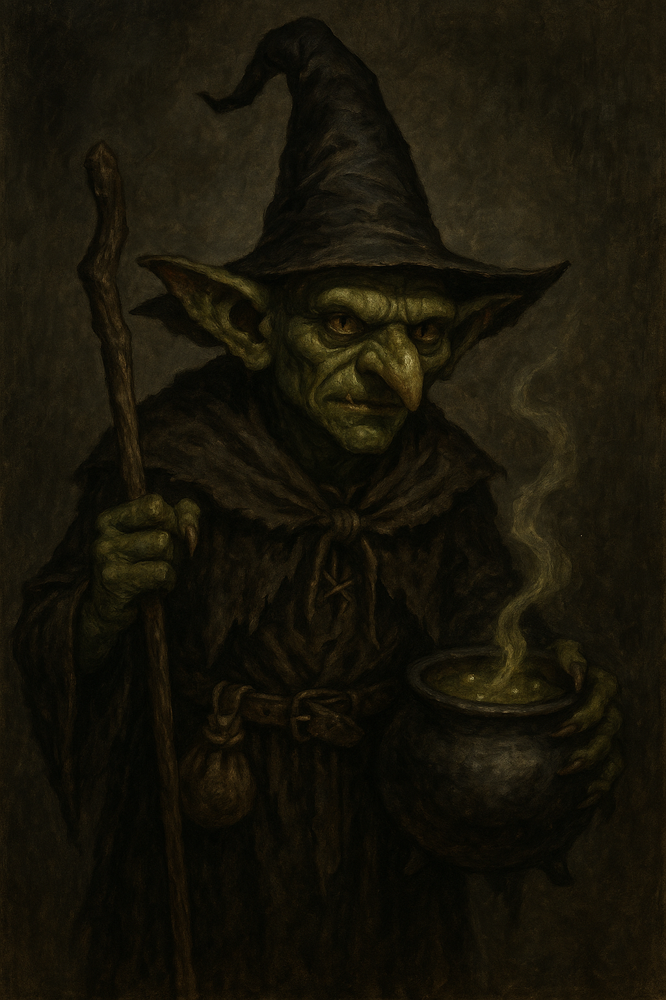
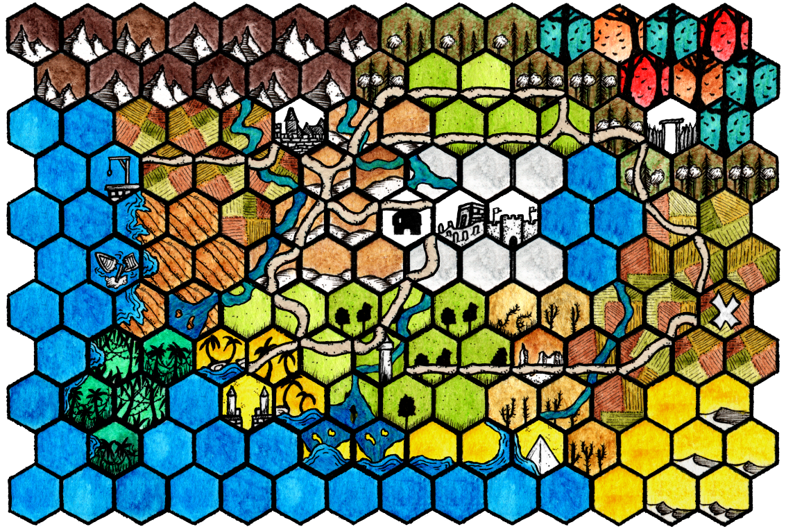

<section class="campaign-hero">

A Shadowdark Campaign Archive

<h2>Hooded Lantern Cartel</h2>

The Hooded Lantern Cartel used Helix as its base while exploring the Barrow Mounds. Its pursuit of a stolen corpse led through Mouse's deliveries to Mort, Mara, and Tornar in the serpent-and-skull marked mound. Eldran Vey's coat and papers…

</section>

## Campaign Now

[Read the full Previously On and current campaign state →](campaign-now/)

## The Party

<a class="party-card internal" href="./party/pc-sab"><strong>Sab</strong><small>Sab is the party's halfling priest: an Old Gods devotee, healer, anti-undead specialist, and frequent voice of caution. Her divine magic, crossbow, and halfling invisibility let her move between support, scouting, and precise violence.</small></a>
<a class="party-card internal" href="./party/pc-oogie"><strong>Oogie</strong><small>Oogie is a Mycellan seer whose trances, omens, and unusual perspective make him the party's occult support and intuitive investigator. His mycelial nature became materially important when the Fair Church restored him in its cemetery…</small></a>
<a class="party-card internal" href="./party/pc-orlin"><strong>Orlin</strong><small>Orlin is a Shadow Elf Beastmaster whose shapechanging, bear-form strength, healing, bow work, and alertness make him a flexible explorer. His bear and wolf forms complement his growing rapport with animals.</small></a>
<a class="party-card internal" href="./party/pc-grond"><strong>Grond</strong><small>Grond is a kobold pit fighter and the party's most direct front-line bruiser. He favors practical force, shields companions in a retreat, and has also shown a surprisingly warm rapport with the people of Helix.</small></a>
<a class="party-card internal" href="./party/pc-gradrick"><strong>Gradrick</strong><small>Gradrick is the party's goblin witch, a back-line spellcaster whose Eyebite and practical magical knowledge have supported the group since its earliest recorded delves.</small></a>
<a class="party-card internal" href="./party/pc-dern">D<strong>Dern</strong><small>Dern is a dwarf Sea Wolf: a Viking-styled martial adventurer introduced during the same strange death-return sequence that restored Oogie.</small></a>

## Latest Session

**Session 22 · 2026-11-08**

In Quasqueton, the party cleared giant red centipedes from an exercise room and Sab claimed a magical lion-faced +1 shield. Thorn-bearing greenkin said two “web takers” had come up the eastern stairs, one going north and one west. In a…

[Quick recap and detailed record →](sessions/2026_1108%20Session%2022)

## Threads in Motion

- **[Greenheart's Captives and Heart Seed](active-leads/thread-greenheart-captives)** — Greenheart told the party that many-eyed beings below Quasqueton trap and steal its children with webs. The group agreed to try its best to return the captives or otherwise secure peace. Sab made the commitment conditional on what the…
- **[Quasqueton / Hollow Gate](places/location-quasqueton)** — Quasqueton, called the Hollow Gate in a damaged writ recovered from Tornar's rooms, is the party's current expedition site. After clearing the upper harpy nest and meeting Greenheart, the party continued through the upper corridors in…
- **[Katherine Guy](people/npc-katherine-guy)** — Katherine Guy is the party's current torchbearer and camp helper. The group hired her at the Brazen Strumpet for one gold per day, rising to two on a day involving combat.
- **[Lion-Faced Shield](items/item-lion-faced-shield)** — Sab recovered this shield from the old exercise room in Quasqueton in Session 22. Its metal face depicts a roaring lion with a flowing mane. It adjusted to fit her and is a **+1 shield** when equipped. It has additional magical properties;…
- **[Arch / Archie](people/npc-arch-archie)** — Arch is the red devil-like figure associated with the party's strange tickets, deaths, and returns. Whether “Archie” names the figure, the tickets, or a broader system remains unresolved in the players' understanding.
- **[Archie ticket](items/item-archie-ticket)** — A death-return ticket tied to Archie, used to restore a dead companion through a still only partly understood ritual or contract.
- **[Beyond the Fog](active-leads/thread-beyond-the-fog)** — The party's world is beginning to widen beyond Helix and the western Barrow Mounds. Oogie's fading tablet map showed more mounds and a castle beyond them. Vakish identified the castle as Castle Zentolin and described the fog as the reason…
- **[Castle Zentolin](places/location-castle-zentolin)** — Legendary castle seen in Oogie's fading tablet-map vision and later named by Vakish. It sits on a crystal-clear lake beyond/east of the Barrow Mounds and has been cut off from contact by the fog.

## Recent Sessions

- **[Session 22 · 2026-11-08](sessions/2026_1108%20Session%2022)** — In Quasqueton, the party cleared giant red centipedes from an exercise room and Sab claimed a magical lion-faced +1 shield. Thorn-bearing greenkin said two “web takers” had come up the eastern stairs, one going north and one west. In a…
- **[Session 21 · 2026-11-01](sessions/2026_1101%20Session%2021)** — The party left Greenheart's nursery and explored more of Quasqueton's upper corridors. They subdued a many-eyed, arachnid-orc hunter and used Oogie's rapport spores to perceive a great spiderlike female controlling similar creatures and…
- **[Session 20 · 2026-10-11](sessions/2026_1011%20Session%2020)** — The party explored Quasqueton's upper passages, killed two venomous centipedes, and followed a plant-altered rat to Greenheart's nursery. A pristine doorway also opened onto Lumpy's familiar equipment storeroom, where Oogie bought rope.…

## The Valley of Ruin

[Open the full map and regional guide](maps/valley-of-ruin)

## Explore

[Campaign Now](campaign-now/) · [Party](party/) · [Sessions](sessions/) · [World](world/) · [Leads](active-leads/) · [Timeline](timeline/) · [Maps](maps/) · [Archive](archive/)
