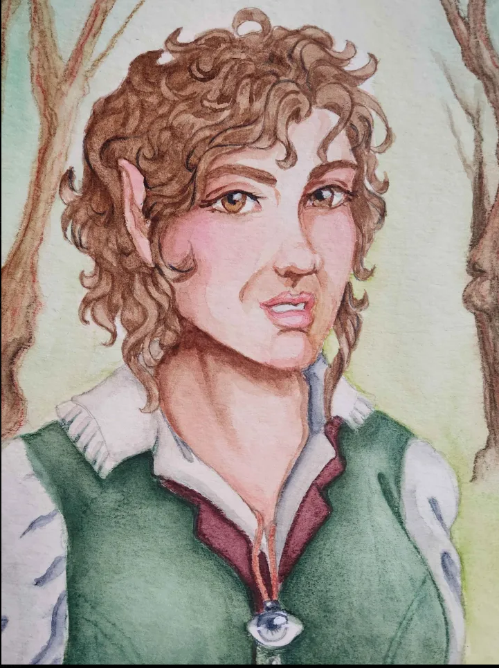
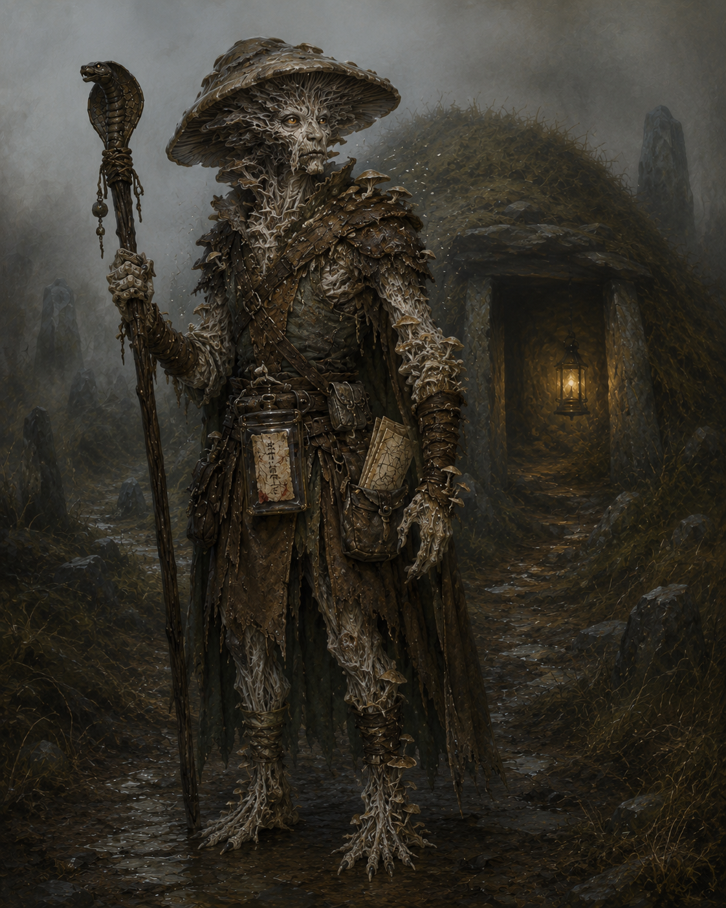
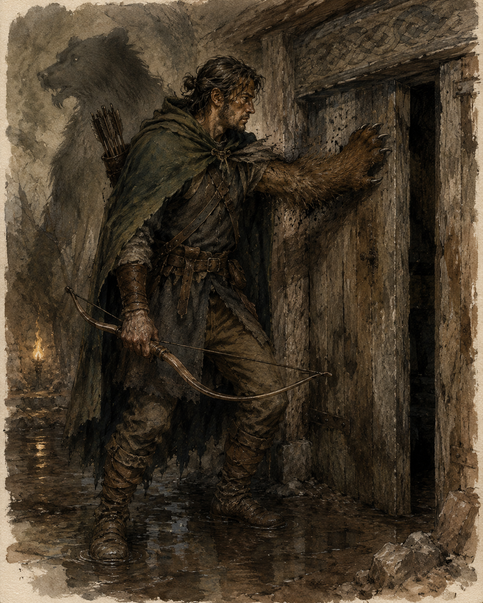
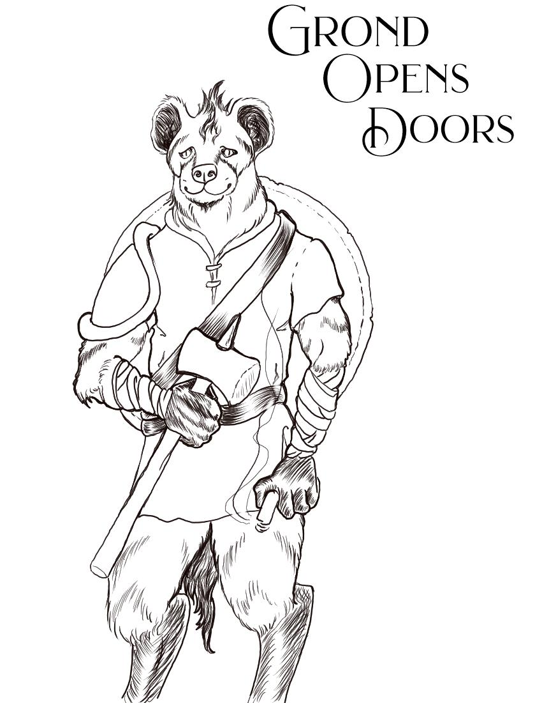
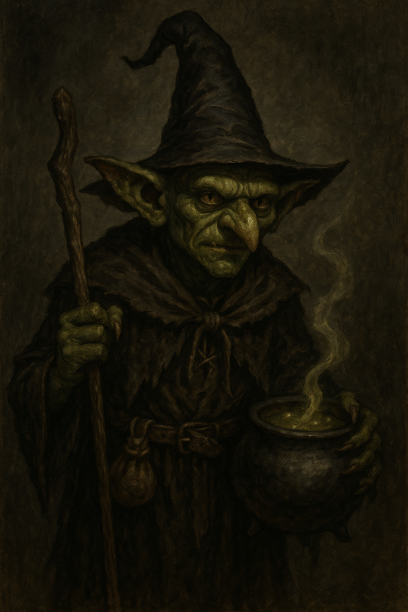
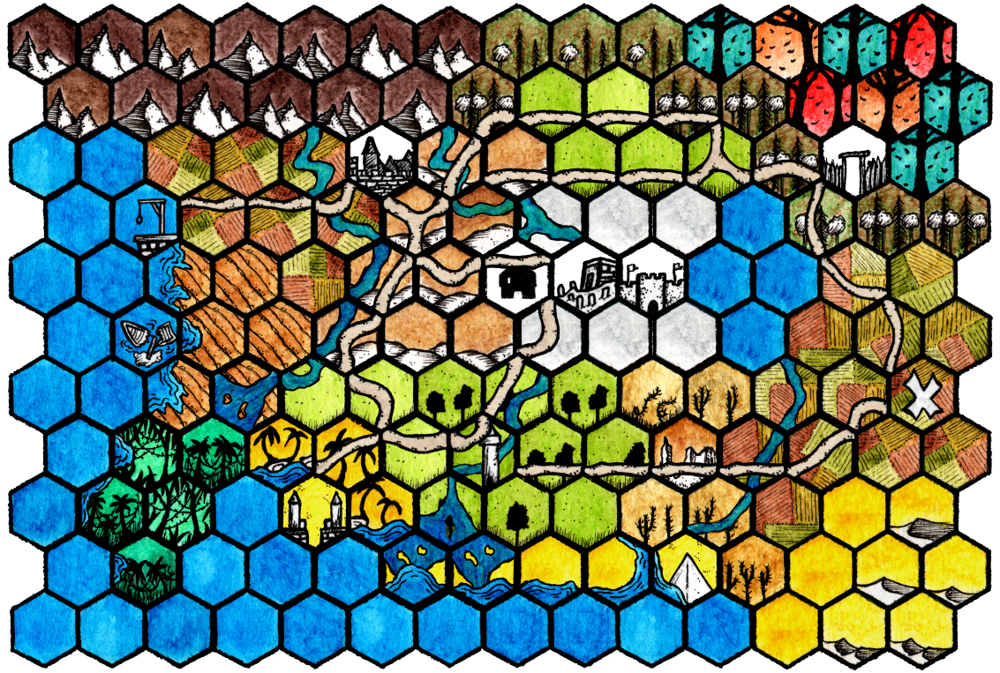

<section class="campaign-hero">

A Shadowdark Campaign Archive

<h2>Hooded Lantern Cartel</h2>

The Hooded Lantern Cartel used Helix as its base while exploring the Barrow Mounds. Its pursuit of a stolen corpse led through Mouse's deliveries to Mort, Mara, and Tornar in the serpent-and-skull marked mound. Eldran Vey's coat and papers…

</section>

## Campaign Now

[Read the full Previously On and current campaign state →](campaign-now/)

## The Party

<a class="party-card internal" href="./party/pc-sab"><strong>Sab</strong><small>Sab is the party's halfling priest: an Old Gods devotee, healer, anti-undead specialist, and frequent voice of caution. Her divine magic, crossbow, and halfling invisibility let her move between support, scouting, and precise violence.</small></a>
<a class="party-card internal" href="./party/pc-oogie"><strong>Oogie</strong><small>Oogie is a fungal seer whose trances, omens, and unusual perspective make him the party's occult support and intuitive investigator. His mycelial nature became materially important when the Fair Church restored him in its cemetery compost…</small></a>
<a class="party-card internal" href="./party/pc-orlin"><strong>Orlin</strong><small>Orlin is a shapechanging adventurer whose bear-form strength, healing, bow work, and alertness make him a flexible explorer. The table has described him as a beastmaster-in-training; a more exact class label has not been established in the…</small></a>
<a class="party-card internal" href="./party/pc-grond"><strong>Grond</strong><small>Grond is a kobold pit fighter and the party's most direct front-line bruiser. He favors practical force, shields companions in a retreat, and has also shown a surprisingly warm rapport with the people of Helix.</small></a>
<a class="party-card internal" href="./party/pc-gradrick"><strong>Gradrick</strong><small>Gradrick is the party's witch, a back-line spellcaster whose Eye Bite and practical magical knowledge have supported the group since its earliest recorded delves.</small></a>
<a class="party-card internal" href="./party/pc-dern">D<strong>Dern</strong><small>Dern is a dwarf Sea Wolf: a Viking-styled martial adventurer introduced during the same strange death-return sequence that restored Oogie.</small></a>

## Latest Session

**Session 19 · 2026-09-27**

The party completed its overnight rest in Quasqueton's entrance guardroom, then explored a vaulted fountain hall. Fresh seed husks, oversized rodent tracks, and faint bitter incense indicated activity inside. To make outside provisioning…

[Quick recap and detailed record →](sessions/2026_0927%20Session%2019)

## Threads in Motion

- **[Owl of Magnus](items/item-crystal-owl)** — The Owl of Magnus is a magical crystal owl recovered from one of Vakish's barrow leads and identified by Mazzah. Its bound user can see through its eyes at a distance, making it one of the party's strongest scouting tools.
- **[Quasqueton / Hollow Gate](places/location-quasqueton)** — Quasqueton, called the Hollow Gate in a damaged writ recovered from Tornar's rooms, is the party's current expedition site. The party completed its guardroom rest and cleared the upper harpy nest in Session 19. Play ended in the upper…
- **[Staff of the Cobra](items/item-cobra-headed-staff)** — A fine dark-wood +1 staff topped by a carved cobra head, recovered from a lectern between two lizardfolk statues in the broken-sigil mound.
- **[The Hollow Gate Writ](active-leads/thread-hollow-gate-writ)** — The party recovered a damaged legal-looking writ from Tornar's rooms. It names the Hollow Gate of Quasqueton and grants a lawful bearer custody of its road-house, outer wall, spring, cave-mouth, stable court, and surrounding grounds,…
- **[Katherine Guy](people/npc-katherine-guy)** — Katherine Guy is the party's current torchbearer and camp helper. The group hired her at the Brazen Strumpet for one gold per day, rising to two on a day involving combat.
- **[Arch / Archie](people/npc-arch-archie)** — Arch is the red devil-like figure associated with the party's strange tickets, deaths, and returns. Whether “Archie” names the figure, the tickets, or a broader system remains unresolved in the players' understanding.
- **[Archie ticket](items/item-archie-ticket)** — A death-return ticket tied to Archie, used to restore a dead companion through a still only partly understood ritual or contract.
- **[Beyond the Fog](active-leads/thread-beyond-the-fog)** — The party's world is beginning to widen beyond Helix and the western Barrow Mounds. Oogie's fading tablet map showed more mounds and a castle beyond them. Vakish identified the castle as Castle Zentolin and described the fog as the reason…

## Recent Sessions

- **[Session 19 · 2026-09-27](sessions/2026_0927%20Session%2019)** — The party completed its overnight rest in Quasqueton's entrance guardroom, then explored a vaulted fountain hall. Fresh seed husks, oversized rodent tracks, and faint bitter incense indicated activity inside. To make outside provisioning…
- **[Session 18 · 2026-09-20](sessions/2026_0920%20Session%2018)** — The party explored the approach to Quasqueton, found edible berries and mushrooms, and learned from a fox that winged hunters threatened the lakeside. A song drew Sab up the trail until Grond restrained her. Two harpies attacked; Sab…
- **[Session 17 · 2026-09-13](sessions/2026_0913%20Session%2017)** — The party returned to Helix, identified the marked-mound finds, sold its ordinary valuables, reported Mort's fate to the Fair Church, and hired Katherine Guy as an expedition helper. Mazzah identified several useful objects and interpreted…

## The Valley of Ruin

[Open the full map and regional guide](maps/valley-of-ruin)

## Explore

[Campaign Now](campaign-now/) · [Party](party/) · [Sessions](sessions/) · [World](world/) · [Leads](active-leads/) · [Timeline](timeline/) · [Maps](maps/) · [Archive](archive/)
