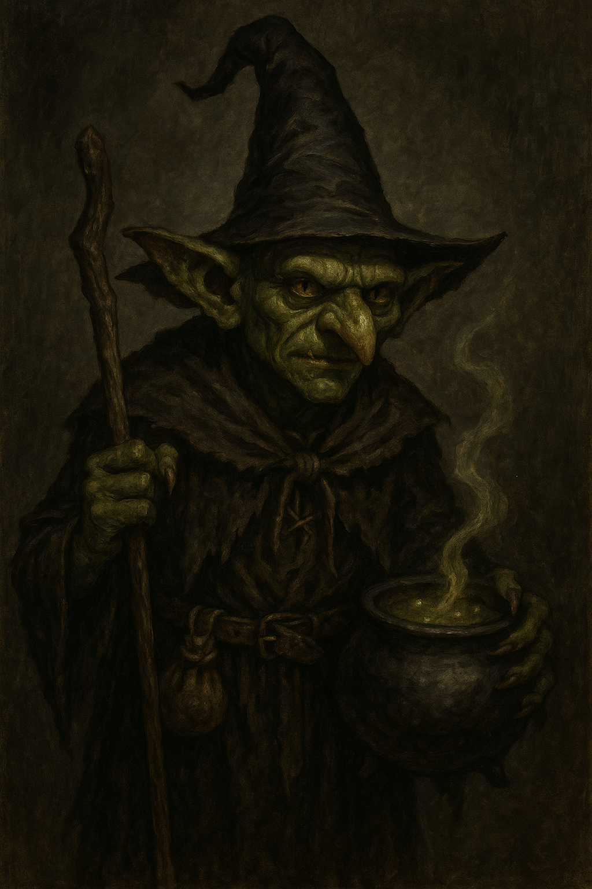

<figure class="entity-art">

</figure>

# Gradrick

## At a Glance

Gradrick is the party's goblin witch, a back-line spellcaster whose Eyebite and practical magical knowledge have supported the group since its earliest recorded delves.

## Identity

- **Ancestry:** Goblin.
- **Class:** Witch.
- **Reported languages:** Common, Diabolic, Goblin, Primordial, and Sylvan.

## Current Situation

Gradrick is with the party at the pool chamber in [[location-quasqueton|Quasqueton]] after [[2026_1108 Session 22|Session 22]]. Gradrick hypnotized a centipede, tested the pools, lit his lantern and identified a rotating false wall. Oogie restored his spent luck. The group opened a hidden wall to an unexplored room. Everyone was awarded five XP.

## Documented Spells and Abilities

This is a record of confirmed choices and demonstrated abilities, not a complete character sheet.

- **Eyebite:** repeatedly used in combat, including the killing blow against the main clockwork cobra. Earlier records often spell it Eye Bite.
- **Fog:** creates a cloud that moves with him and makes attacks against creatures inside it harder; used during the Quasqueton approach.
- **Keen Senses:** cannot be surprised, as explicitly reported for his goblin ancestry.
- **Splat:** his flying frog familiar has bat wings. Gradrick reported that he can cast spells through it.
- **Familiar teleport:** his level-three talent lets him teleport to his familiar once per day; reported in Session 19 and reaffirmed in Session 20.

Hypnotize was successfully cast in Session 21; the hunter was stupefied until Gradrick failed to maintain focus. The spellbook is now supported by a demonstrated casting. The Charm Person scroll likewise does not establish a permanently learned spell. His magic-carpet casting at White Falls used a scroll that was consumed.

## Item-Granted Powers

- **[[item-crystal-owl|Owl of Magnus]]:** lets its bound user see through the owl's eyes at a distance. Gradrick used it to watch both the marked mound and Quasqueton's hallway; it is distinct from Splat.

## Defining History

- Helped finish the corpse-eating creature on the road to Helix and damaged the northern barrow's gray ooze with Eye Bite.
- Supported the retreat from the red-robed watcher after Oogie's fall.
- Helped decipher the faded Thornswild writing in the flooded ceremonial tomb.
- Accepted custody of the Charm Person scroll recovered from a flooded sarcophagus.
- Used the [[item-crystal-owl|Owl of Magnus]] to watch the marked mound and witnessed Mouse's knock signal and delivery to its large occupant.
- Helped assess Tornar's workroom, took the finger-bone wand after the rite, and retained Tornar's incoherent notes for later study.
- Finished the main clockwork cobra with Eye Bite and took Eldran Vey's identifying coat and supporting papers.

## Notable Possessions

- [[item-crystal-owl|Owl of Magnus]], recovered after the marked-mound expedition
- Charm Person spell scroll
- Hypnotize spellbook

## Relationships

- **Mazzah:** magical consultant and current custodian of the party's dangerous skin-bound spellbook.
- **Mouse:** observed through the owl while Mouse supplied the marked mound.
- **The party:** long-standing magical support across the dungeon, Helix, and Barrow Mounds arcs.

## Uncertainty

Transcript spellings of Gradrick's name are unusually unstable; the aliases above refer to the same PC.

In Session 20 he reported Charisma 16 and recalled that his first talent had increased his primary stat, but was uncertain about that talent's exact origin or wording. His temporary newt form in Session 18 was a spell mishap, not an acquired shapechanging ability.

## Garden Connections

- [Greenheart](../people/npc-greenheart)
- [Quasqueton / Hollow Gate](../places/location-quasqueton)
- [Sab](../party/pc-sab)
- [Oogie](../party/pc-oogie)
- [Orlin](../party/pc-orlin)
- [Grond](../party/pc-grond)
- [Dern](../party/pc-dern)
- [Mazzah](../people/npc-mazzah)
- [Serpent-and-Skull Marked Mound](../places/location-serpent-skull-marked-mound)
- [Tornar](../people/npc-tornar)
