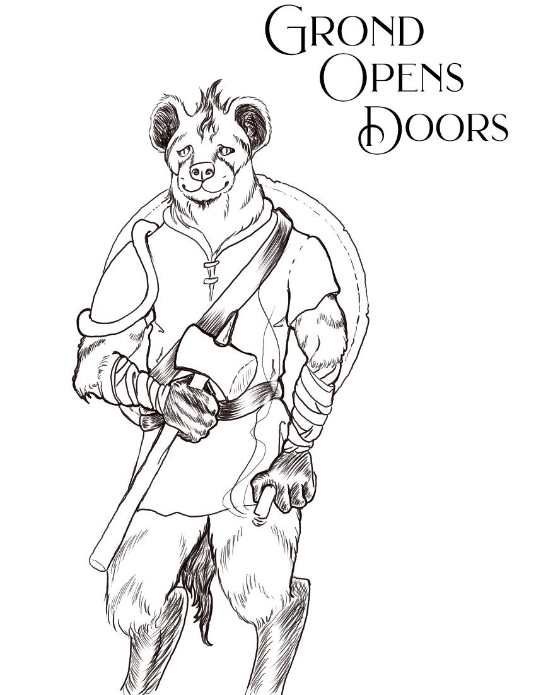

<figure class="entity-art">

</figure>

# Grond

## At a Glance

Grond is a kobold pit fighter and the party's most direct front-line bruiser. He favors practical force, shields companions in a retreat, and has also shown a surprisingly warm rapport with the people of Helix.

## Identity

- **Ancestry:** Kobold.
- **Class:** Pit Fighter.

## Current Situation

Grond is at the newly opened exercise room in [[location-quasqueton|Quasqueton]]. In [[2026_1101 Session 21|Session 21]] he guarded the rear during the hunter encounter, found and enlarged a concealed entrance into the greenkin mothers' storeroom, and located a second small exit. He left through the first entrance as it healed shut, then forced the swollen exercise-room door. No rear attacker or new injury was established. He reported three torches and two rations. His last confirmed level/XP report was level four, 0/40; Sessions 20 and 21 awarded no XP. He retains the [[item-hero-belt-gold-and-unicorn-horn-buckle|Belt of the Thornswild]] and [[item-werner-s-lucky-sledgehammer|Werner's sledgehammer]].

## Documented Spells and Abilities

These abilities were explicitly reported during the Session 20 sheet check; this is not a complete character sheet.

- **Walk It Off:** once per day, ignores all damage and effects from one attack.
- **Flourish:** reported as three uses per day; regains 1d6 hit points when he hits someone with a melee attack.

## Item-Granted Powers

- **[[item-hero-belt-gold-and-unicorn-horn-buckle|Belt of the Thornswild]]:** grants +4 Strength while worn. This bonus comes from the belt, not an ancestry or class talent.

The Rage effects Grond has received are temporary spells cast by Oogie, not an ability Grond has been shown to activate himself.

## Defining History

- Fought through the road ambush and the party's first northern-barrows expedition.
- Refused to disarm during Nabo's hostage demand and emerged from the deadly camp confrontation with Werner's hammer recovered.
- Carried the Barrow Mounds retreat after Oogie fell and helped protect Mox during the later snake retreat.
- Won goodwill in Helix during the great Brazen Strumpet feast, including a public thank-you from Bolo and an enthusiastic audience of local children.
- Removed the hero belt from the Thornswild battle tableau, survived the resulting fight, and later kept it with Vakish's agreement.
- Helped Oogie reconstruct the fading tablet map before it vanished.
- Approached the marked mound's door, received Sab's Holy Weapon blessing, and struck one of Tornar's rising bodies.
- Offered physical comfort to Mort after Turn Undead ended the animation.
- Helped Mort into bed with Mara's wedding cord, then crushed both an eastern-crypt zombie and a smaller clockwork snake with his sledgehammer.

## Notable Possessions

- [[item-hero-belt-gold-and-unicorn-horn-buckle|Belt of the Thornswild]]
- Werner's recovered sledgehammer

## Relationships

- **Vakish Baharus:** gave the party the belt-buckle lead and ultimately accepted Grond keeping the belt.
- **Bolo and Helix:** Grond's conduct during the feast earned him unusual local affection.
- **The party:** shield-bearing frontliner and frequent solution to barred stone or wood.

## Uncertainty

The sledgehammer is sometimes called a warhammer in noisy transcripts. The campaign record treats those mentions as Werner's recovered hammer unless later play establishes a second weapon.

## Garden Connections

- [Greenheart](../people/npc-greenheart)
- [Quasqueton / Hollow Gate](../places/location-quasqueton)
- [Sab](../party/pc-sab)
- [Oogie](../party/pc-oogie)
- [Orlin](../party/pc-orlin)
- [Gradrick](../party/pc-gradrick)
- [Dern](../party/pc-dern)
- [Bolo](../people/npc-bolo)
- [Vakish Baharus](../people/npc-vakish-baharus)
- [Belt of the Thornswild / Gold-and-Unicorn-Horn Buckle](../items/item-hero-belt-gold-and-unicorn-horn-buckle)
- [Mort](../people/npc-mort)
- [Tornar](../people/npc-tornar)
- [Serpent-and-Skull Marked Mound](../places/location-serpent-skull-marked-mound)
