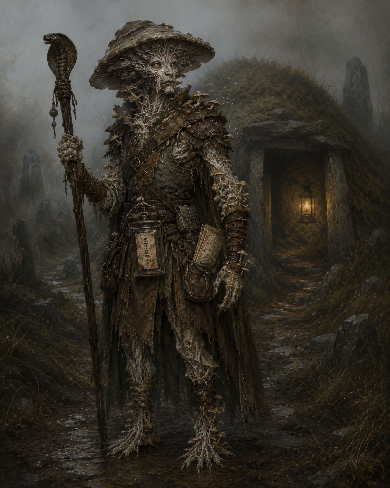

<figure class="entity-art">

</figure>

# Oogie

## At a Glance

Oogie is a Mycellan seer whose trances, omens, and unusual perspective make him the party's occult support and intuitive investigator. His mycelial nature became materially important when the Fair Church restored him in its cemetery compost after a fatal barrow expedition.

## Identity

- **Ancestry:** Mycellan.
- **Class:** Seer.

## Current Situation

Oogie is with the party at the pool chamber in [[location-quasqueton|Quasqueton]] after [[2026_1108 Session 22|Session 22]]. Oogie used Omen on two pools, drank cool water and a liquid that briefly gave him an orange aura, restored Gradrick’s luck and split an ochre jelly with Fate. Some of his rope dissolved in a corrosive pool; 40 feet remained by the table ruling. The group opened a hidden wall to an unexplored room. Everyone was awarded five XP.

## Documented Spells and Abilities

This is a record of confirmed choices and demonstrated abilities, not a complete character sheet.

- **Trance:** grants another creature a luck token and has accompanied shared glimpses of possible futures, including the tablet chamber and the Three Cairns encounter.
- **Evoke Rage:** usually called Rage in play; empowers a companion's strength and damage. Its normal duration requires the target to keep attacking; the extended stealth use in Session 19 was a temporary allowance.
- **Fate:** selected as his tier-two spell in Session 20; damages a target and removes its luck tokens. Cast twice against the many-eyed hunter in Session 21, dealing ten and eight damage.
- **Foresight and luck support:** uses called Omen in play have revealed possible dangers and restored companions' luck. The record does not establish Omen as a separate learned spell.
- **Rapport spores:** used to enable direct communication with Nara and the party in the marked mound, and with the many-eyed hunter, Sab, and Orlin in Session 21. The latter use was described as ten rounds of psychic understanding without a shared language.
- **Mycelial contact:** connected to Quasqueton's growth and perceived Greenheart's nursery and its altered rats. The wider limits of this ability remain unstated.
- **Wisdom talent:** added +2 Wisdom during the Session 20 sheet check, bringing Wisdom to 16.

## Item-Granted Powers

- **[[item-cobra-headed-staff|Staff of the Cobra]]:** +1 staff with a once-daily transformation into a serpent servant; snakes regard Oogie as friendly. The cobra returns to staff form if killed. Session 19's once-per-game allowance did not replace the daily limit.

## Defining History

- Died after being isolated by a trap and attacked by marked skeletons beneath a prominent barrow.
- Returned through the Archie-ticket mystery and the Fair Church's intervention.
- Used Trance to reveal the tablet chamber in the Thornswild tomb and helped preserve part of the map that appeared when the tablet turned to ash.
- Took the cobra-headed staff from the broken-sigil mound and led the retreat when snakes emerged.
- Had Mazzah identify the staff in [[2026_0628 Session 14|Session 14]] and sold a chipped red gemstone for 20 gold.
- Used the Staff of the Cobra to make the marked mound's painted serpent treat him as friendly.
- Recovered a wooden tongue carving, a claw-and-bone talisman, journals, and valuables from Tornar's living quarters.
- Foretold Grond's first strike against the eastern crypt's ravenous dead and restored luck to Gradrick and Orlin during the clockwork fight.
- Recovered the most intact set of smaller clockwork-snake components after Sab cut the construct cleanly in half.

## Notable Possessions

- [[item-cobra-headed-staff|Staff of the Cobra]]
- Rough copy of the tablet's Barrow Mounds map
- Returning dagger, passed to him by Sab
- Half of an [[item-archie-ticket|Archie ticket]] retained after his return
- Clockwork venom reservoir, retained for possible use with the returning dagger

## Relationships

- **Dern:** entered the campaign through the same strange return sequence and was told to look after Oogie.
- **Mazzah:** the party's principal magical consultant and the person who identified Oogie's staff.
- **The Fair Church:** enabled Oogie's restoration despite Mort's hostility.

## Uncertainty

The copied tablet map is explicitly imperfect. Its larger geography should be treated as a lead, not a precise survey.

## Garden Connections

- [Greenheart](../people/npc-greenheart)
- [Quasqueton / Hollow Gate](../places/location-quasqueton)
- [Sab](../party/pc-sab)
- [Orlin](../party/pc-orlin)
- [Gradrick](../party/pc-gradrick)
- [Grond](../party/pc-grond)
- [Dern](../party/pc-dern)
- [Mazzah](../people/npc-mazzah)
- [The Barrow Mounds](../places/location-barrow-mounds)
- [Serpent-and-Skull Marked Mound](../places/location-serpent-skull-marked-mound)
- [Tongue of the Beast](../items/item-wooden-tongue-carving)
- [Talisman of the Beastmaster](../items/item-claw-and-bone-talisman)
