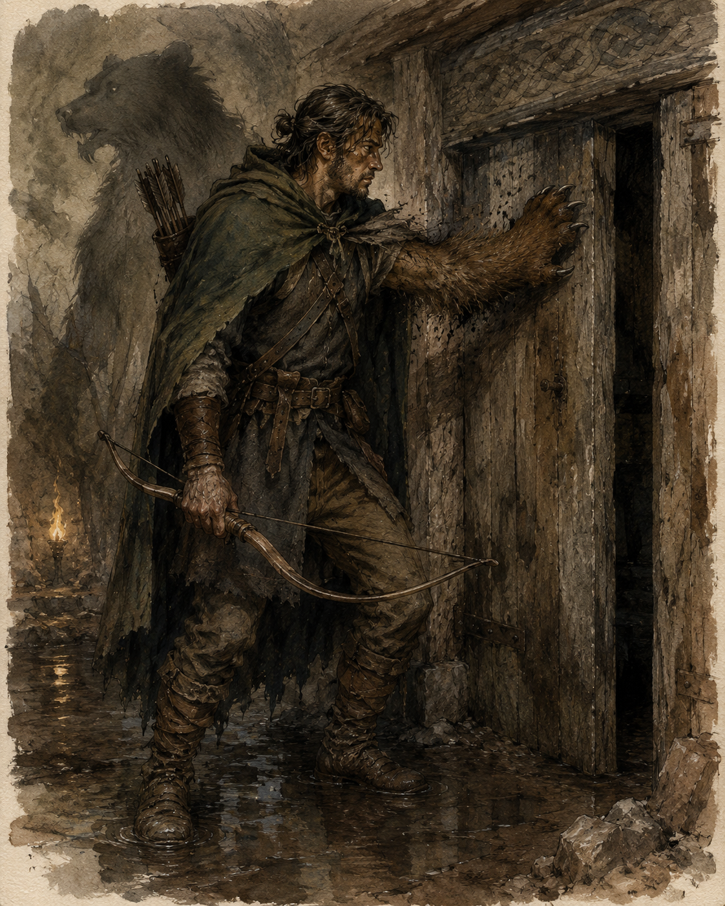

<figure class="entity-art">

</figure>

# Orlin

## At a Glance

Orlin is a Shadow Elf Beastmaster whose shapechanging, bear-form strength, healing, bow work, and alertness make him a flexible explorer. His bear and wolf forms complement his growing rapport with animals.

## Identity

- **Ancestry:** Shadow Elf.
- **Class:** Beastmaster.
- **Reported languages:** Bear, Canine, Common, Drow, and Elvish.

## Current Situation

Orlin is with the party at the pool chamber in [[location-quasqueton|Quasqueton]] after [[2026_1108 Session 22|Session 22]]. Orlin spoke with thorn-bearing greenkin, fought centipedes and an ochre jelly, noticed a breeze and opened the rotating hidden wall. Sab healed his injuries. The group opened a hidden wall to an unexplored room. Everyone was awarded five XP.

## Documented Spells and Abilities

This is a record of confirmed choices and demonstrated abilities, not a complete character sheet.

- **Bear and wolf forms:** bear claws and strength have supported combat and forced entrances; wolf form helped resolve the Three Cairns encounter peacefully.
- **Additional beast form:** his first talent granted a second Beastmaster form, accounting for access to both bear and wolf forms.
- **Friend of the Shadows:** when Orlin is in darkness, monsters attack allies first.

## Item-Granted Powers

- **[[item-wooden-tongue-carving|Tongue of the Beast]]:** after a turn focusing on one kind of animal, permits communication with that animal type. Orlin has used it with a fox and the altered rats; it did not let him speak directly with Greenheart.
- **[[item-claw-and-bone-talisman|Talisman of the Beastmaster]]:** grants +1 to natural attacks. Once daily, a successful claw wound can attract a nearby ordinary animal, curious but uncontrollable. Orlin activated this power in Session 20; whether it caused the rat guide's return remains uncertain.
- **[[item-session-15-spell-scroll-tube|Scroll of Spectacle]]:** a held scroll, not evidence of a learned spell.
- **[[item-blue-cloud-potion|Blue cloud substance]]:** produces weightlessness, with flight or levitation depending on its use; it is a consumable rather than an innate ability.

## Defining History

- Returned through the Archie-ticket system during the early dungeon expedition.
- Made the party's first direct gesture toward the red-robed watcher when the figure appeared in the mist and waved back.
- Used literal bear hands to force open swollen doors in the flooded ceremonial tomb.
- Helped read the Thornswild chamber's faded writing and fought the animated lizardfolk statues.
- Drew out Mouse's delivery story while the party investigated the marked mound.
- Killed Tornar in bear form after the ritualist's animation attempt failed.
- Tore apart a ravenous zombie, held off the main clockwork cobra, and recovered its ruby eyes and unfamiliar mechanical heart.
- Used wolf form to resolve the Three Cairns encounter peacefully.

## Notable Possessions

- [[item-blue-cloud-potion|Blue cloud weightlessness substance]]
- [[item-claw-and-bone-talisman|Talisman of the Beastmaster]]
- [[item-wooden-tongue-carving|Tongue of the Beast]]
- [[item-session-15-spell-scroll-tube|Scroll of Spectacle]]

## Relationships

- **Mouse and Dennis:** Orlin's direct conversation exposed the delivery schedule and the recipient's foul-smelling mound.
- **Tornar:** killed the ritualist after Tornar animated the dead.
- **The party:** a core companion from the early dungeon through the current Helix investigation.

## Uncertainty

Earlier records described Orlin as a beastmaster-in-training. The Session 20 class and talent discussion explicitly identified him as a Beastmaster, with bear and wolf forms.

His second talent remains unidentified: Danny remembered a possible Strength, Constitution, or unarmored-AC increase but did not establish which. Earlier play records healing and magical support without establishing a complete spell list.

## Garden Connections

- [Greenheart](../people/npc-greenheart)
- [Sab](../party/pc-sab)
- [Oogie](../party/pc-oogie)
- [Gradrick](../party/pc-gradrick)
- [Grond](../party/pc-grond)
- [Dern](../party/pc-dern)
- [Serpent-and-Skull Marked Mound](../places/location-serpent-skull-marked-mound)
- [Tornar](../people/npc-tornar)
- [Blue Cloud Weightlessness Substance](../items/item-blue-cloud-potion)
