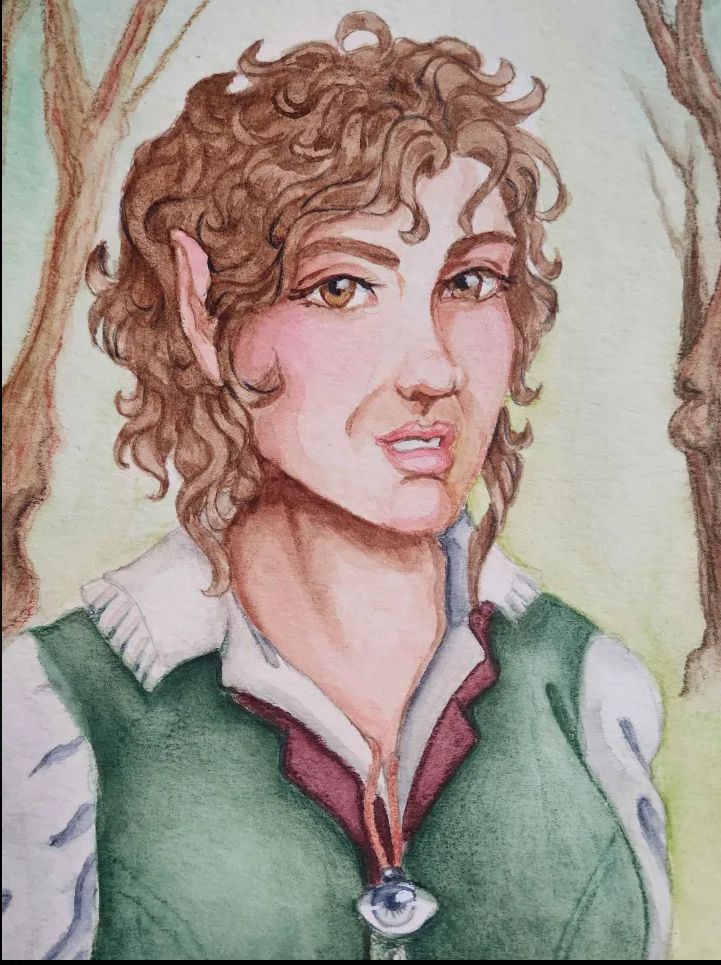

<figure class="entity-art">

</figure>

# Sab

## At a Glance

Sab is the party's halfling priest: an Old Gods devotee, healer, anti-undead specialist, and frequent voice of caution. Her divine magic, crossbow, and halfling invisibility let her move between support, scouting, and precise violence.

## Identity

- **Ancestry:** Halfling.
- **Class:** Priest.
- **Devotion:** Odin, Skyfather, also addressed as the Allfather.

## Current Situation

Sab is with the party in [[npc-greenheart|Greenheart's]] nursery in [[location-quasqueton|Quasqueton]]. In [[2026_1011 Session 20|Session 20]] she lit her shield, killed a centipede with Smite, then covered the shield to avoid frightening the rats. She drank the draught Mazzah had given Gradrick, interpreted Greenheart, and conditionally agreed to try to recover its children or secure peace. She introduced herself as a devotee of Odin, Skyfather. She remains level four with 0/40 XP reported at the opening; no XP was awarded. She retains the Hollow Gate papers, her silver-finished mirror, and the approach's fishing pole and salt.

## Documented Spells and Abilities

This is a record of confirmed choices and demonstrated abilities, not a complete character sheet.

- **Cure Wounds:** used to heal Grond after the Thornswild tomb's spike pit, among other healing scenes.
- **Holy Weapon:** used to bless Grond's hammer before entering the marked mound.
- **Turn Undead:** used during barrow retreats and Tornar's rite, where it ended the undead activity and destroyed Nara.
- **Smite:** used against ravenous zombies and a Quasqueton centipede.
- **Blind/Deafen:** the spellbook came from Mazzah; her later blinding of a harpy confirms she could cast it.
- **Protection from Evil:** used to protect companions during the harpy encounters. Session 19's simultaneous protection of two targets was a temporary allowance, not an ongoing expansion of the spell.
- **Light:** cast on her shield in Session 20.
- **Cleansing Weapon:** selected as a tier-two spell in Session 19; no casting has yet been recorded.
- **Halfling invisibility:** used for scouting, including entry into Quasqueton. This ancestry ability is distinct from her cloak.
- **Talents:** +1 to ranged attack rolls at level one and +2 Strength from her level-three talent, both confirmed in the Session 20 sheet check.

## Item-Granted Powers

- **[[item-cloak-of-elvenkind|Cloak of Elvenkind]]:** helps the wearer hide and has described stealth/invisibility properties; separate from halfling invisibility.

The plant speech used with Greenheart came from a consumed draught, not a learned spell or permanent ability.

## Defining History

- Helped destroy the gray ooze in the northern barrow and left with Tiramel's returning dagger.
- Scouted Werner's camp invisibly during the confrontation that killed Ikram, Nabo, and Werner.
- Used Turn Undead during the party's worst barrow retreats and helped bring Oogie to the Fair Church for restoration.
- Earned Gant's confidence when he showed her a Steel Bone half-mask found beneath Mort's bed.
- Honored the disturbed Thornswild dead and recovered the preserved shroud later identified as a [[item-cloak-of-elvenkind|Cloak of Elvenkind]].
- Reported the party's surveillance of the serpent-and-skull mound to Gant in [[2026_0628 Session 14|Session 14]].
- Cast Holy Weapon on Grond's hammer before the party entered the mound.
- Used Turn Undead during Tornar's rite, ending the undead activity before Mara returned as a living person.
- Recovered and read the damaged Writ of the Hollow Gate.
- Conducted a funeral observance for Mara and placed Mara's wedding cord in Mort's hand.
- Used Smite to destroy two ravenous zombies and made a successful combat debut with her longsword against a smaller clockwork snake.
- Destroyed the identified Wand of Unlife rather than risk its unknown necromantic cost.
- Told the Fair Church what happened to Mort and learned that Bartholomew would still welcome him back.

## Notable Possessions

- [[item-cloak-of-elvenkind|Cloak of Elvenkind]]
- Blind/Deafen spellbook
- A Steel Bone half-mask connected to the suspicion around Mort

Sab passed Tiramel's returning dagger to Oogie in Session 12.

## Relationships

- **Gant:** a Fair Church contact who trusts Sab with his concerns about Mort.
- **Mort:** a grieving former church worker whom Sab treated with dignity after Mara's failed animation.
- **The party:** Sab is the most consistently documented healer and one of its strongest defenses against undead.

## Uncertainty

Sab explicitly introduced herself to Greenheart as a devotee of Odin, Skyfather, in Session 20. Earlier records use broader Old Gods language; no narrower doctrinal structure is established.

## Garden Connections

- [Greenheart](../people/npc-greenheart)
- [Quasqueton / Hollow Gate](../places/location-quasqueton)
- [Oogie](../party/pc-oogie)
- [Orlin](../party/pc-orlin)
- [Gradrick](../party/pc-gradrick)
- [Grond](../party/pc-grond)
- [Dern](../party/pc-dern)
- [Gant](../people/npc-gant)
- [The Fair Church](../places/location-fair-church)
- [Tornar](../people/npc-tornar)
- [Writ of the Hollow Gate](../items/item-writ-of-hollow-gate)
