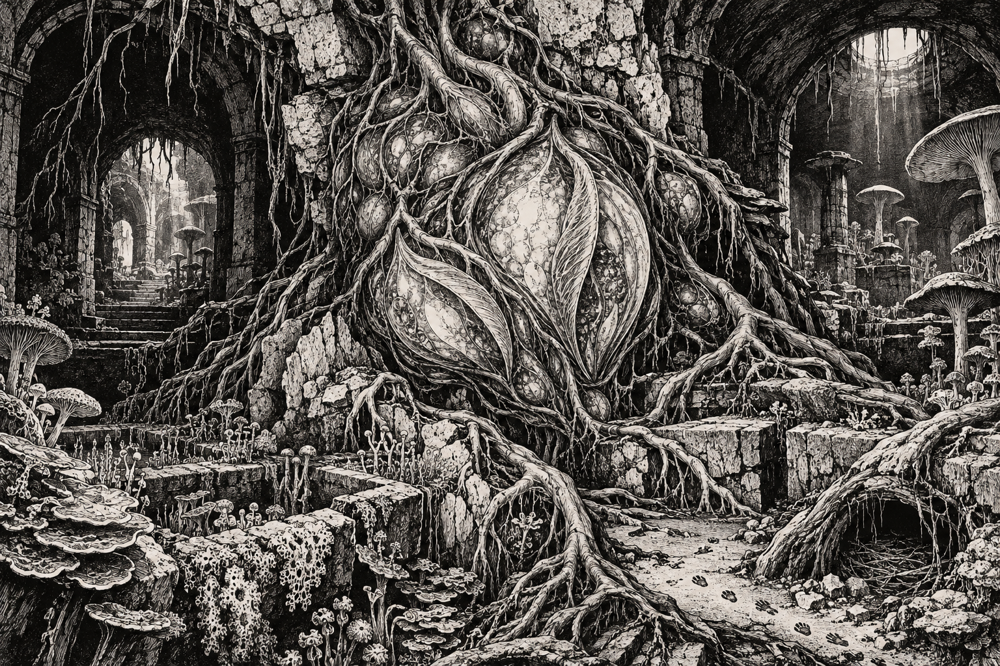
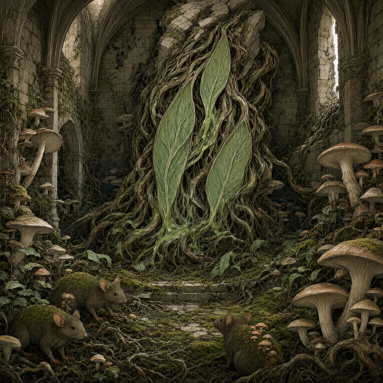
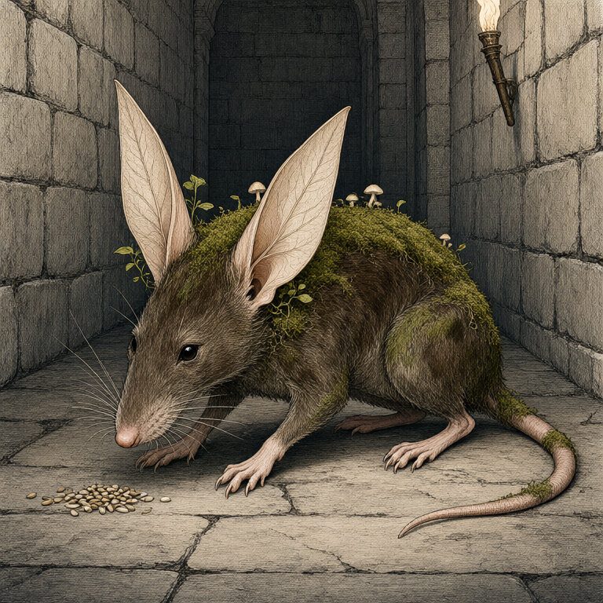
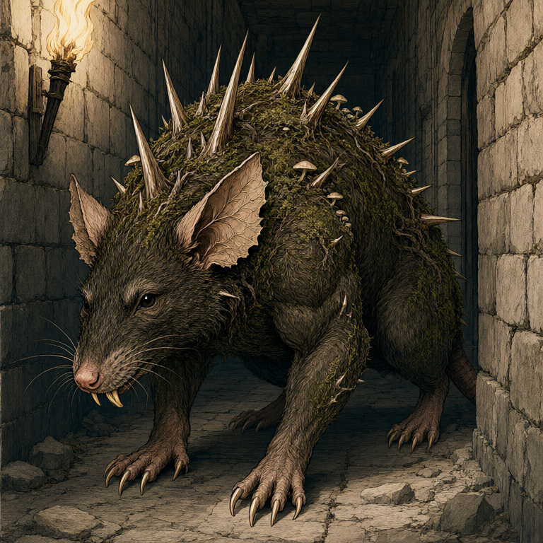

# Greenheart

Greenheart is a sentient plant in Quasqueton's upper nursery, with three main chambers that glow and pulse like a slow heartbeat. It presides over rats altered by moss, leaves, fungi, or thorns. The party made peaceful contact in [[2026_1011 Session 20|Session 20]] and remains in its chamber.

## The Nursery

An old swollen door with iridescent mold opens onto deep vegetation, bioluminescent fungi, and two raised stone planters used as nests. Orlin spoke with the rats through the Tongue of the Beast. They dislike strong light and fear fire and the webbed ones; defensive-looking inhabitants did not attack the party. Sab covered her lit shield and Katherine extinguished her torch. Oogie's mycelial contact had already revealed the nursery without suggesting general hostility.

## Request to the Party

After Sab drank Mazzah's plant-speaking draught, Greenheart told her that many-eyed beings below trap and steal its children with webs. It offered a heart seed if the party returned the captives or secured peace, asking that the seed be returned to its northern home. Sab accepted if the party could accomplish it, without promising success or a timetable. No heart seed has been received. See [[thread-greenheart-captives|Greenheart's captives and heart seed]].

## What the Vision Showed

The party drank Greenheart's sap and shared a fragmentary vision of an elven forest city, a purple-robed wizard bargaining with a high elf, the wizard stealing a three-chambered seed, darkness descending over the forest, and later laboratory experiments. Greenheart called this its home. The party associated the wizard with Zelligar the Unknown, but his identity was not confirmed. The vision is Greenheart's presented account; the forest's current state and location are unknown.

The rats would prefer a more open, safe environment. Neither their relocation nor the seed's transport procedure has been established.

## Garden Connections

- [Parent: Quasqueton / Hollow Gate](../places/location-quasqueton)
- [Quasqueton / Hollow Gate](../places/location-quasqueton)
- [Sab](../party/pc-sab)
- [Oogie](../party/pc-oogie)
- [Orlin](../party/pc-orlin)
- [Greenheart's Captives and Heart Seed](../active-leads/thread-greenheart-captives)
