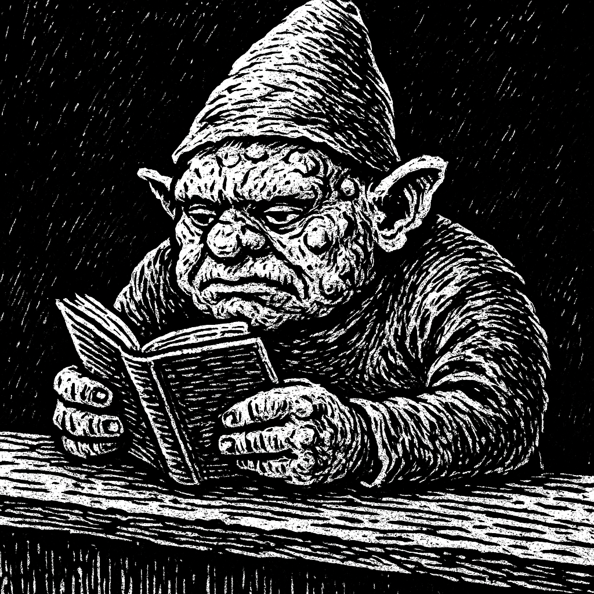

# Lumpy

Lumpy is the familiar rock gnome outfitter encountered through a pristine door in [[location-quasqueton|Quasqueton's]] upper passages in [[2026_1011 Session 20|Session 20]]. He sat reading behind a desk in a warm, well-lit, well-stocked equipment room resembling the Locked and Loaded LLC storeroom from the party's first adventure.

Oogie entered the room and bought 60 feet of rope for one gold. Lumpy set the rope on the desk without looking away from his book. The door closed immediately after Oogie returned to the castle, while continuing to look new.

Wade identified the male gnome as Lumpy and distinguished him from his sister, whom the party recalled meeting elsewhere. The doorway's nature, persistence, and the storeroom's physical location remain unexplained; it has not been established as a permanent shop in the castle.

## Garden Connections

- [Quasqueton / Hollow Gate](../places/location-quasqueton)
- [Locked and Loaded Tower](../places/location-locked-and-loaded-tower)
- [Oogie](../party/pc-oogie)
