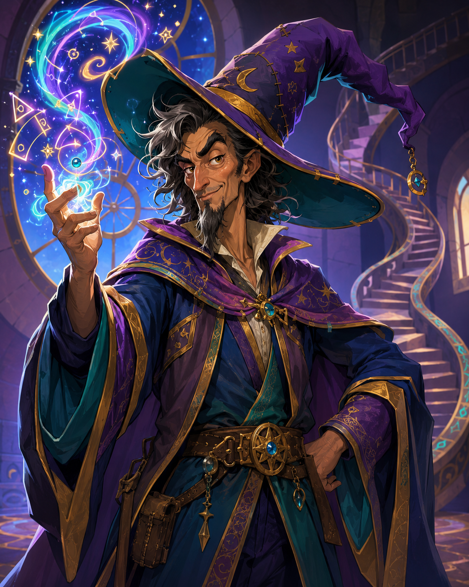

<figure class="entity-art">

</figure>

# Mazzah

Mazzah is Helix's eccentric wizard and the party's most reliable magical consultant. He is cooperative when approached on his terms, which are advertised by the many increasingly emphatic “do not disturb” signs around his tower.

## What the Party Knows

- Studied Werner's silver goblet and demonstrated that it could produce mead once per day before its magic ran out.
- Identified the potion of invisibility, bag of holding, Owl of Magnus, Cloak of Elvenkind, and Staff of the Cobra.
- Marked the mound north of the obelisk on the party's map.
- Keeps unusual objects for study and has become a trusted custodian for dangerous magic.

## Session 14

Mazzah identified Oogie's staff as a +1 Staff of the Cobra that can become a large serpent servant once per day. He bought Oogie's chipped red gemstone, accepted a skin-bound dark-arts spellbook for safekeeping, and gave Sab and Gradrick spellbooks containing Blind/Deafen and Hypnotize.

He associated the marked mound's symbol with an evil serpent-and-death tradition. His comments did not prove the exact deity or confirm that the site belongs to the Steel Bone Brotherhood.

## Session 17

Mazzah identified the party's marked-mound finds, including Orlin's weightlessness substance, Talisman of the Beastmaster, Tongue of the Beast, and Scroll of Spectacle. He identified Tornar's finger-bone wand as a Wand of Unlife before Sab destroyed it.

He interpreted Eldran Vey's papers as a possible claim to [[location-quasqueton|Quasqueton]], distinguished that stronghold from Castle Zentolin, and relayed several unverified rumors about its builders and contents. Gradrick left Tornar's journals with him for study and received a plant-speaking draught in exchange.

## Session 23

Through a velvet-curtained passage from [[location-quasqueton|Quasqueton]], the party found Mazzah taking tea with a spectral pony in his sitting room. The pony vanished when they called out. Mazzah said the passage was new to him. He wondered whether one of his tapestries was involved, and he plans to research it. He could exchange objects and talk through the open threshold. When the curtain was drawn, he could not find the opening from his side.

In [[2026_1115 Session 23|Session 23]] he identified the [[item-jewel-of-barbalt|Jewel of Barbalt]], Sab's [[item-lion-faced-shield|Shield of the Lion]], Grond's [[item-beetle-potion-of-animal-shifting|beetle potion]], and Oogie's two tactical healing potions. He judged Orlin's cloak clasp ordinary and refreshed the party's torches.

## Garden Connections

- [Parent: Mazzah's Tower](../places/location-mazahs-tower)
- [Oogie](../party/pc-oogie)
- [Gradrick](../party/pc-gradrick)
- [Sab](../party/pc-sab)
- [Celestia](../people/npc-celestia)
- [Staff of the Cobra](../items/item-cobra-headed-staff)
- [Owl of Magnus](../items/item-crystal-owl)
- [Quasqueton / Hollow Gate](../places/location-quasqueton)
- [Jewel of Barbalt](../items/item-jewel-of-barbalt)
- [Shield of the Lion](../items/item-lion-faced-shield)
- [Beetle Potion of Animal Shifting](../items/item-beetle-potion-of-animal-shifting)
