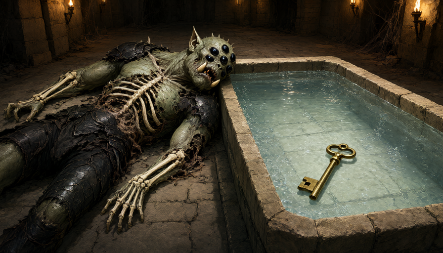

# Session Note

Quick Read

## Executive Summary

In [[location-quasqueton|Quasqueton]], the party cleared giant red centipedes from an exercise room and Sab claimed a magical lion-faced +1 shield. Thorn-bearing greenkin said two “web takers” had come up the eastern stairs, one going north and one west. In a chamber of strange pools the party found a dead silkbound, pulled a brass key from corrosive liquid, defeated an ochre jelly, and tested the pools. A rotating hidden wall revealed another room, unexplored when play stopped. Each character received five XP.

[Jump to the detailed record →](#what-happened)

## What Happened

Katherine lit a torch, Sab renewed Light, and Oogie lit a torch as the party entered the training room. Movement beneath the woven mats proved to be giant red centipedes. Orlin and Sab were bitten but resisted the venom; the party killed the creatures. Gradrick's Eyebite failed despite luck, but he hypnotized the last centipede and Oogie restored his luck with Trance before Grond crushed it.

Behind the mats and ruined equipment Sab found a lion-faced shield. It adjusted to fit her and was identified through use as a +1 shield; its additional magical properties await identification by Mazzah. She equipped it and put her old shield away. The party continued south, replenishing their lights. They saw a broad staircase descending beyond their light and opened a nearby door.

Inside an old carpenter's room, Orlin spoke with thorn-bearing greenkin using the Tongue of the Beast. They said two “web takers” had arrived from the eastern stairs, one traveling north and the other west. They were relieved to hear the party had dealt with one. The group found larger footprints leading west and followed the corridor to an open doorway.

In the next room lay a dead, more muscular silkbound beside a basin of clear, fizzing liquid; the flesh of its arms and torso had dissolved. Wade called the altered orcs “silk-bound.” Oogie saw a large brass key in the basin and tried fishing it out with rope, which dissolved. Sab used the dead creature's iron or steel mace to hook the key out before the mace corroded. The key fizzed briefly outside the pool, then appeared unharmed. Sab carries the recovered key.

The room contained many tiled basins. Oogie used Omen and saw greenkin drinking from one cool pool as it refilled; he drank and found it refreshing. Orlin prodded an orange pool, which rose as an ochre jelly and struck him. Oogie's Fate split it; Sab and Grond destroyed the two portions. Sab healed Orlin's wounds. The party continued testing the basins, finding effects and clues described below.

A breeze near a pool displaying illusory treasure led Gradrick to notice a rotating false wall. Orlin pushed it open, revealing another room. The group checked the remaining accessible pools before stopping. The new room had not been explored.

## Key Scenes / Beats

- The party killed the centipedes under the exercise mats and recovered Sab's lion shield.
- Greenkin in an old carpenter's room described two web takers arriving by the eastern stairs.
- A dead silkbound lay beside a corrosive pool containing a brass key; Sab retrieved the key with its corroding mace.
- Oogie, Sab, and Grond defeated an ochre jelly; Sab healed Orlin.
- The pool chamber yielded several observed effects and a hidden rotating wall leading to an unexplored room.

## PCs In Play

- **[[pc-sab|Sab]]**, halfling priest: survived a centipede bite, healed herself and Orlin, equipped the lion shield, retrieved the key, and helped defeat the jelly. Alive; high confidence.
- **[[pc-oogie|Oogie]]**, Mycellan seer: enraged Grond, restored Gradrick's luck, lost some rope to the corrosive pool, used Omen on two pools, drank from both, and split the jelly with Fate. Alive; high confidence.
- **[[pc-orlin|Orlin]]**, shadow elf beastmaster: fought centipedes, spoke to greenkin, triggered the jelly, detected a breeze, and opened the hidden wall. He was healed after both fights. Alive; high confidence.
- **[[pc-gradrick|Gradrick]]**, goblin witch: failed Eyebite, hypnotized a centipede, lit his lantern, tested pools and identified the hidden wall. Alive; high confidence.
- **[[pc-grond|Grond]]**, kobold pit fighter: crushed centipedes, forced the carpenter-room door, provided torches, killed a jelly portion, and sampled the green pool. Alive; high confidence.

Dern had no played actions this session.

## NPCs Encountered

- **[[npc-katherine-guy|Katherine Guy]]:** accompanied the group, maintained torchlight, and remained with the party. Alive; high confidence.
- **Thorn-bearing greenkin:** sheltered in the former carpenter's room and described the two web takers' movements. Their report is not independent proof of every creature's identity or fate.
- **Dead silkbound:** a larger, muscular arachnid-altered orc with its arms and torso stripped to bone, found beside the corrosive pool. Its death was not witnessed.

## Locations Visited

The party explored Quasqueton's exercise room, an old carpenter's room, upper corridors, and a chamber of tiled pools. A broad descending staircase was seen but not taken. A hidden rotating wall opened onto an unexplored room.

## Factions in Play

Greenheart's greenkin and the silkbound remain connected to the unresolved predation. No new formal faction or allegiance was established.

## What the Players Learned

The pool labels below are the table's navigation labels, not inscriptions shown in the room:

- **A:** shallow opaque pink liquid; no smell or identified effect.
- **B:** clear fizzing liquid dissolves rope and corrodes a mace; a brass key survived removal.
- **C:** gray, sweet-smelling syrup; a little dimmed a torch and a discarded torch did not ignite the basin. Its effect if consumed is unknown.
- **D:** the apparent orange liquid was an ochre jelly, now defeated.
- **E:** cool, refreshing water. Oogie's Omen showed greenkin drinking and the basin refilling.
- **F:** translucent dark-red liquid smelled grapey and alcoholic; the party suspected wine, without tasting it.
- **G:** empty yellow-tiled basin; water poured into it remained water.
- **H:** hot, bubbling clear liquid with a slight sulfur smell.
- **I:** shimmering liquid gave a dipped rope a faint white aura. Omen showed a greenkin glowing blue after drinking; Oogie drank and glowed faint orange for a minute, without producing usable light.
- **J:** swirling green liquid smelled fruity. Grond licked a dipped arrow, briefly felt lightheaded, then recovered after a successful constitution check.
- **K:** small freshwater fish and frequent greenkin tracks.
- **L:** white stone-like material emitted a little vapor and intense cold.
- **M:** apparent gold and gems vanished when the surface was disturbed and returned when still; the treasure appeared illusory. A breeze near the back wall led to the hidden passage.
- **N:** clear liquid made no sound when dripped back into the pool.

## Possible / Unconfirmed Information

The gray pool seen in Oogie's earlier vision has not been securely identified with pool C. Its deadly effect and location remain unverified. Wine, sleep-inducing liquid, holy water, and weapon applications were suggestions; the actual effects are not established. The two web takers' reported directions do not prove that the corpse is the other reported creature. The key's lock and purpose are unknown; Mazzah must identify the shield's remaining magical properties. The hidden room has not been inspected.

## Loot / Artifacts / Rewards

- Sab equipped the magical lion-faced +1 shield; further properties await identification by Mazzah. Her old shield was put away.
- A large brass key was pulled from the corrosive pool and appeared unharmed; Sab carries it.
- Oogie's rope was partly dissolved; Wade allowed him to retain 40 feet. Torches and lantern oil were used or shared during exploration; the record does not reconstruct a complete inventory.
- Five XP was awarded to everyone at the end of the session.

## Encounters / Combat Outcomes

The centipedes were killed. Sab and Orlin resisted their venom and were healed. The ochre jelly hit Orlin, split after Fate, and both portions were destroyed; Sab healed him again. No party death was reported.

## Open Threads / Unresolved Hooks

Explore the room behind the false wall; identify the key and shield; investigate the untested pool effects cautiously; and continue Greenheart's rescue-or-peace request. The controller, missing captives, heart seed, and the deadly gray-pool vision remain unresolved. The broad stairs descend beyond the party's light. Light supplies and a future rest remain concerns.

## Party Intent / Likely Next Steps

Play resumes at the hidden room off the pool chamber. The party discussed exploring that room after checking the last pool. A return to camp was discussed in relation to supplies and time, but not undertaken or firmly scheduled.
